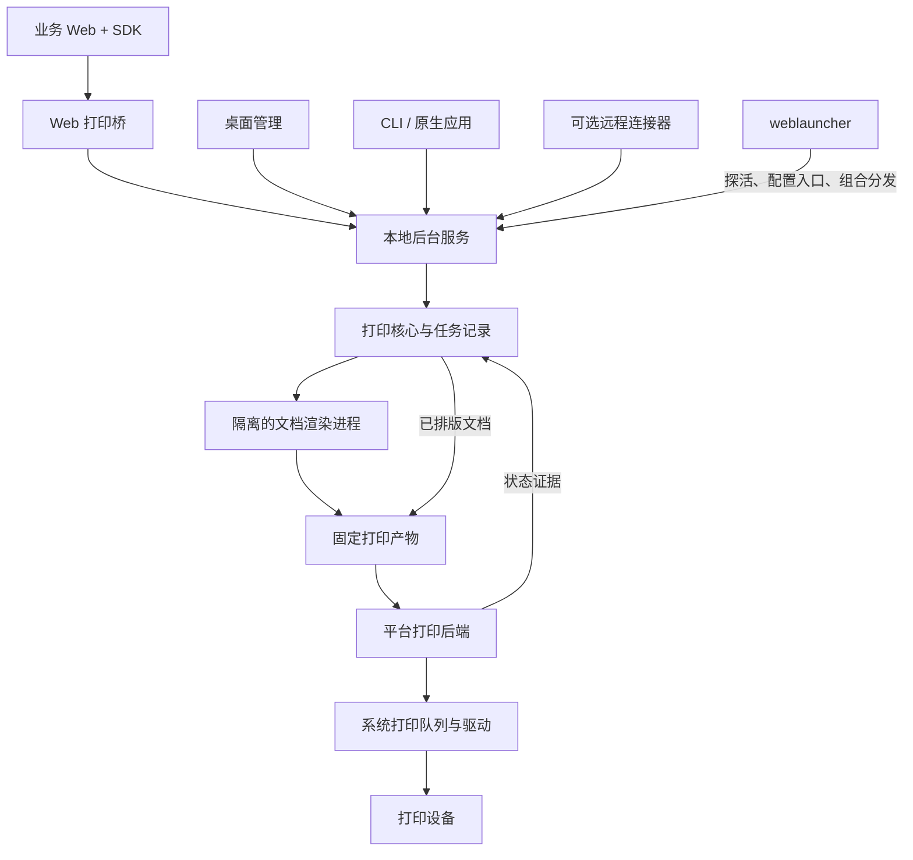

# 架构草案

状态：候选方案，等待技术验证。更新日期：2026-09-29。

## 总体结构

建议以可复用的打印核心为基础，由独立后台服务承担本地持久化与执行。Web 打印桥、桌面管理、CLI 和未来远程连接器通过统一的任务接口接入。

图中箭头表示职责间的调用或数据流，不表示每个方框都必须成为独立进程、公开库或单独发布的服务。

## 模块与接口

| 模块 | 调用方应理解的接口 | 内部承担的复杂性 |
| --- | --- | --- |
| 打印核心 | 接收打印意图、查询任务、订阅变化、请求取消或补打 | 任务规则、执行尝试、能力校验、状态归一与恢复判断 |
| 文档渲染 | 源文档与排版选项输入，固定打印产物输出 | 资源装配、字体就绪、打印样式、分页、引擎隔离 |
| 平台打印后端 | 查询队列与能力、提交产物、查询或取消队列任务 | 系统 API、驱动参数、格式转换、原始状态差异 |
| 本地后台服务 | 调用方身份、版本化任务协议、状态查询 | 进程生命周期、存储、权限、执行调度、资源限制 |
| 接入端 | Web、CLI、桌面或远程侧习惯的调用形式 | 通信转换与接入体验，共用任务语义 |

核心库不依赖 DOM、桌面框架或某一种通信协议。三个平台的打印后端具有真实差异，适合建立适配接口；只有一种实现且无变化需求的辅助代码，不必先拆成公开库。

初期使用一个仓库管理模块即可。具体目录形式取决于最终选择的语言；多模块不意味着同时使用多种核心语言、发布多个包或引入动态插件系统。

## 现有 Web 如何迁移

建议沿用业务现有的打印文档准备逻辑，把最后一步从“打开浏览器打印对话框”改为“提交完整的打印文档和打印意图”。源文档、必要资源和打印意图被本地服务持久化受理后，后续执行不再依赖调用方持续在线。

普通网页没有标准接口可以直接获取本次浏览器打印排版的 PDF 字节。独立 Chromium 渲染器可以使用打印媒体样式生成 PDF，但需要重新装配文档并进行排版。[HTML 打印规范](https://html.spec.whatwg.org/multipage/timers-and-user-prompts.html#printing)、[Puppeteer PDF 接口](https://pptr.dev/api/puppeteer.page.pdf)

HTML 接入应定义为可重放的文档包，至少明确：

- 静态打印内容，以及表单当前值的呈现方式
- 打印 CSS、必要的样式作用域与相对资源地址基准
- 图片、字体及其他资源的内容身份与获取方式
- 纸张、方向、边距、缩放及背景图形策略
- 资源就绪条件、引擎版本和可接受的支持范围

不能把 `outerHTML` 等同于页面全部状态。例如 canvas 绘制内容需要显式移交；表单运行时属性在序列化为 HTML 时也需要明确处理。采集屏幕计算样式不等于保留打印媒体规则。[DOM 克隆说明](https://developer.mozilla.org/en-US/docs/Web/API/Node/cloneNode)

业务单据中的控制按钮隐藏、字段取舍、双联内容与颜色规则仍归业务文档准备逻辑所有。通用 SDK 提供打包与通信帮助，并通过明确的接入契约保证可重放性。

默认不让渲染器执行任意业务脚本，不自动继承浏览器登录态。资源优先随包提供；需要外部资源时，应显式约定来源、权限和可重放条件。

## 源文档、产物与打印后端

首个候选路径为 HTML 文档包经过受控渲染形成 PDF；调用方已有固定 PDF 时，可以跳过 HTML 渲染。后续再根据真实设备需求扩展其他输入和产物。

PDF 是排版交换格式，不是所有打印机都直接理解的设备语言。Windows RAW 写入不会替调用方解释 PDF，需要验证 PDF 渲染到驱动的路径；CUPS 的输入也依赖转换链和设备配置。[Windows RAW 数据类型](https://learn.microsoft.com/en-us/windows-hardware/drivers/print/raw-data-type)、[CUPS 设计](https://www.cups.org/doc/spec-design.html)

纸张、边距、缩放及驱动选项需要协同处理。能力不匹配时应返回明确结果或要求调用方选择回退策略，不能静默更改成默认纸张或默认设备。

## 运行方式与进程隔离

后台核心与用户界面分离。Windows Service、macOS LaunchDaemon、Linux 系统服务是无人登录运行的候选宿主；用户托盘或桌面管理界面拥有独立生命周期。

系统服务与用户界面之间需要明确身份、设备绑定及任务可见性。同一任务不能被系统服务和用户态宿主分别执行。首版优先验证一个后台执行宿主与多个接入端的结构。

原生 WebView 或隐藏桌面窗口不能直接等同于无人登录渲染。例如 macOS 的系统 daemon 不能依赖 WindowServer。候选 headless Chromium 工作进程也必须在目标版本、权限和冷启动环境中验证，不能仅依据隐藏窗口测试承诺能力。[Apple daemon 设计](https://developer.apple.com/library/archive/documentation/MacOSX/Conceptual/BPSystemStartup/Chapters/DesigningDaemons.html)、[Chrome Headless](https://developer.chrome.com/docs/automation-and-testing/headless)

渲染进程与后台核心隔离，限制权限、外部资源、并发和运行时长。浏览器引擎故障不应直接终止任务账本；原生驱动调用是否需要独立工作进程，由阻塞和崩溃测试决定。

## 任务语义

任务接收成功只表示请求通过校验并持久化，后续执行需要查询。事件通知用于及时更新视图，持久化查询用于重连和恢复；不能只依赖一次进程内回调。

建议保留以下记录：

| 记录 | 内容 |
| --- | --- |
| 任务 | 调用方身份、去重键、源文档引用、打印意图、创建时间 |
| 固定产物 | 内容摘要、生成版本、纸张与排版参数 |
| 执行尝试 | 执行归属、阶段、错误、起止时间及系统队列任务引用 |
| 状态证据 | 来源、原始状态、观察时间与可解释的规范状态 |
| 补打关系 | 新任务关联原任务，保留操作人和原因 |

去重键在调用方身份范围内生效；同一键对应不同内容应报冲突。对于已受理的重复请求，应返回原任务的身份和状态。

执行阶段至少区分准备、渲染、待提交、提交中和已提交系统队列。系统队列接受、系统报告完成、设备确认输出是不同证据等级，不能统一压成无来源的“打印成功”。[Windows 队列状态](https://learn.microsoft.com/en-us/windows/win32/printdocs/job-info-2)

提交前失败可以按策略重试。提交中进程退出，或已提交后状态丢失，都可能意味着打印已经发生；先恢复核对证据，无法确认时进入结果待确认。不能仅凭超时、租约到期或本地记录缺失自动重新提交。

未提交任务可以取消；已进入系统队列的任务只能请求队列取消，并报告确认结果。取消请求不能保证收回已发生的输出。

本地记录与系统打印队列之间不存在天然的原子事务。持久化和去重能够降低重复风险，但不能据此承诺所有设备都实现物理上的恰好一次打印。

## 接入协议与授权

原生调用方可通过系统 IPC 接入；Web 调用方通过单独的本地通信入口接入同一任务语义。具体采用 HTTP、WebSocket 或浏览器扩展 Native Messaging，由兼容验证决定。

本地 Web 接入需要检查回环监听、请求来源、主机目标及调用方权限，并考虑来源伪造和 DNS rebinding。CORS 不是授权机制，Origin 校验也不能作为识别所有本地程序的唯一依据。

首次授权与每次打印交互分开：用户可以授权某业务应用及其打印范围，授权后无需每张单据再打开打印对话框；授权应可查看和撤销，不能把长期共享密钥公开写在网页代码里。

浏览器本地网络访问规则需要按目标浏览器版本验证，不能假定所有 HTTPS 页面都能无条件访问 localhost，也不能假定 WebSocket 永远不受限制。Native Messaging 是另一个接入适配选项，需要额外的扩展和本地宿主分发。[本地网络访问](https://developer.mozilla.org/en-US/docs/Web/Security/Defenses/Local_network_access)、[Native Messaging](https://developer.chrome.com/docs/extensions/develop/concepts/native-messaging)

原生入口与 Web 入口都不应暴露任意命令执行或任意文件读取。文档解析和渲染按不受信任输入处理。

## 性能策略

静默打印省去了对话框交互，不会消除排版、分页、字体处理和驱动渲染。独立工作进程能够解除业务页面对打印对话框生命周期的依赖，但仍与浏览器竞争客户机资源。

先分段测量页面文档准备、传输与持久化、HTML 渲染、队列提交和首张出纸。候选优化包括复用渲染进程、限制并发、去重资源、直接接受既有 PDF，以及按内存阈值回收工作进程。

浏览器 DOM 采集本身也可能占用主线程，需要独立测量。只有证据说明本地渲染不可接受时，再评估远程渲染或其他排版方式的适用场景与代价。

## 与 weblauncher 的关系

本地源码检查显示，weblauncher 使用 Go 与系统托盘，网页交给外部浏览器打开；现有自启入口属于用户登录会话。它目前不是独立打印服务，也不自动拥有外部浏览器文档的控制能力。[weblauncher 项目](https://github.com/Vanisper/weblauncher)

建议以版本化协议组合两个项目。weblauncher 可以发现打印服务、显示健康状态、打开管理界面，并在安装包中组合分发独立组件；打印服务由自己的宿主管理，退出 launcher 不应结束打印任务。

## 技术候选与决定条件

以下是工程取舍，不是已批准的技术选型：

| 选项 | 适合优先考虑的条件 | 需要承担的成本 |
| --- | --- | --- |
| Rust | 核心库复用和原生 API 适配占比高 | FFI、安全封装、异步与多平台构建维护 |
| Go | 服务、任务管理与 IPC 是主工作量，团队熟悉 Go | 接入原生库后的 cgo 与平台构建约束 |
| Zig | 团队熟悉 Zig，确有 C ABI 或底层适配方面的明确收益 | 系统绑定、依赖整合、服务和桌面周边建设 |

Rust 支持面向其他语言宿主的库产物；Go 的 cgo 有指针与交叉构建约束；Zig 可以导出 C ABI。这些机制都不能替代真实的打印平台适配。[Rust linkage](https://doc.rust-lang.org/reference/linkage.html)、[Go cgo](https://pkg.go.dev/cmd/cgo)、[Zig C ABI](https://ziglang.org/documentation/master/#Exporting-a-C-Library)

先验证 HTML 渲染、PDF 到系统驱动、无人登录运行和浏览器接入四个关键接口，再冻结核心语言与框架。多语言嵌入 ABI、第三方插件系统和复杂框架选型等到存在具体调用方后再决定。
